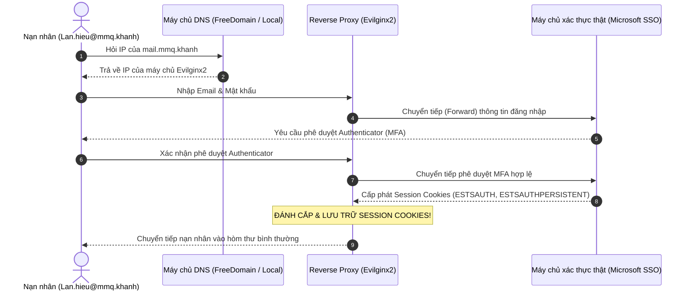
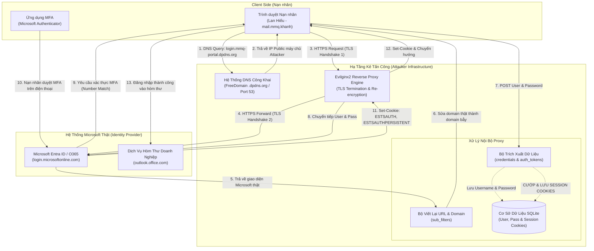

# Dự Án IAO202: Bypass MFA bằng Reverse Proxy - AiTM

> **Chuyên ngành:** An Toàn Thông Tin 
> **Project Timeline:** 19/10/2026 ➔ 30/10/2026  
> **Nhóm thực hiện:** Lương An, Khanh, Hiếu, Quang  

---

## 📖 1. Tổng Quan và Cơ Chế Kỹ Thuật 

### Khác biệt bản chất giữa Phishing truyền thống và AiTM Reverse Proxy:
* **Phishing truyền thống (Credential Harvesting):** Kẻ tấn công tạo một trang web tĩnh giả mạo giao diện để lừa nạn nhân nhập username và password
  => Khi hệ thống bật MFA (mã OTP hoặc xác nhận qua Authenticator), kẻ tấn công chỉ có mật khẩu mà không thể đăng nhập vì thiếu mã MFA (mã OTP hết hạn sau 30-60 giây).
* **Tấn công AiTM (Adversary-in-the-Middle) qua Reverse Proxy:**
  - Kẻ tấn công **không cần tự xây dựng trang web đăng nhập giả**. Thay vào đó, máy chủ Reverse Proxy (sử dụng **Evilginx2**) hoạt động như một lớp màng lọc trung gian hoàn toàn trong suốt.
  - Nạn nhân tương tác với hệ thống thật qua proxy: đọc email, chuyển tiếp request, nhập OTP, duyệt thông báo xác thực như bình thường.
  - **Mục tiêu là Session Theft:** Khi người dùng hoàn tất bước xác thực MFA với máy chủ thật, máy chủ thật sẽ cấp phát **Session Cookie** (ví dụ: `ESTSAUTH`, `ESTSAUTHPERSISTENT` của Microsoft). Reverse Proxy bắt trọn gói tin chứa Session Cookie này, cho phép kẻ tấn công nạp cookie vào trình duyệt và chiếm quyền điều khiển tài khoản vĩnh viễn cho đến khi cookie die => bypass MFA.

---

## 📌 2. Attack Script | Scenario: Công Ty MMQ

* **Victim:** Nhân viên Lan Hiếu (`Lan.hieu@mmq.khanh`) thuộc Công ty Cổ phần MMQ.
* **Hình thức tiếp cận:** Gửi Email mạo danh Bộ phận Quản trị CNTT (IT Department) thông báo *"Mật khẩu tài khoản Office365/Email của bạn đã hết hạn trong 24 giờ tới. Vui lòng bấm vào liên kết để gia hạn mật khẩu"*.
* **Đường dẫn bẫy:** Trỏ về tên miền được proxy qua Evilginx: `mail.mmq.khanh` (hoặc subdomain public).
* **Quá trình thực thi:**
  1. Nạn nhân bấm vào liên kết, thấy trang web hiển thị y hệt hệ thống thật.
  2. Nạn nhân nhập mật khẩu và hoàn tất bước xác nhận ứng dụng Microsoft Authenticator.
  3. Reverse proxy chuyển tiếp toàn bộ lưu lượng tới máy chủ Microsoft thật.
  4. Microsoft chứng thực hợp lệ và trả về Session Cookie.
  5. Evilginx bắt giữ Session Cookie và lưu trữ vào cơ sở dữ liệu của kẻ tấn công.



---

## 🔄 3. Data Flow: How It Works & How It Attacks

### 3.1. Sơ Đồ Luồng Dữ Liệu Toàn Cục (Architectural Data Flow)



---

### 3.2. How It Works: Cơ Chế Kỹ Thuật 4 Tầng

Kỹ thuật Reverse Proxy AiTM hoạt động dựa trên sự phối hợp đồng bộ của 4 tầng mạng:

1. **Tầng 1 - Phân giải tên miền động (DNS Delegation):**
   * Tên miền bẫy (ví dụ: `mmq-portal.dpdns.org`) được ủy quyền bản ghi `NS` trỏ về IP của máy chủ Evilginx.
   * Evilginx tự đóng vai trò là Authoritative Nameserver, vừa trả lời truy vấn DNS cho nạn nhân, vừa giải quyết thử thách ACME DNS-01 để nhận chứng chỉ SSL Let's Encrypt màu xanh hợp lệ.
2. **Tầng 2 - Cầu nối TLS Kép (Dual TLS Termination & Re-encryption):**
   * **Kết nối 1 (Victim ➔ Proxy):** Được mã hóa bằng TLS với chứng chỉ của tên miền bẫy. Trình duyệt hiển thị ổ khóa an toàn màu xanh.
   * **Kết nối 2 (Proxy ➔ Real Microsoft):** Được mã hóa bằng TLS với chứng chỉ chính chủ của Microsoft.
   * ➔ **Điểm mấu chốt:** Tại điểm giữa (bộ nhớ RAM của Evilginx), toàn bộ dữ liệu gói tin được giải mã thành **văn bản rõ (Plaintext HTTP)**. Proxy có toàn quyền đọc, sửa đổi và trích xuất dữ liệu trước khi mã hóa lại gửi đi.
3. **Tầng 3 - Viết lại nội dung động thời gian thực (`sub_filters`):**
   * Khi máy chủ Microsoft trả về mã HTML/JS có chứa liên kết `login.microsoftonline.com`, bộ lọc `sub_filters` của Phishlet lập tức thay thế thành `login.mmq-portal.dpdns.org`.
   * Nhờ đó, mọi cú click chuột, request Ajax hay submit form tiếp theo của nạn nhân đều tiếp tục chảy qua máy chủ proxy mà không bị văng sang trang thật.
4. **Tầng 4 - Bóc tách Token & Đánh cắp phiên (`auth_tokens`):**
   * Sau khi bước xác thực MFA hoàn tất, Microsoft trả về Header phản hồi `Set-Cookie`.
   * Regex Engine của Evilginx quét và tóm trọn 2 cookie quyết định:
     * `ESTSAUTH`: Token phiên xác thực đang hoạt động.
     * `ESTSAUTHPERSISTENT`: Token duy trì đăng nhập dài hạn.
   * Cookie được lưu tức thì vào SQLite database mà không cần nạn nhân hay Microsoft hay biết.

---

### 3.3. How It Attacks: Vòng Đời Tấn Công 5 Giai Đoạn

| Giai đoạn | Tên gọi | Hành vi kỹ thuật chi tiết |
| :---: | :--- | :--- |
| **P1** | **Chuẩn bị (Weaponization)** | • Lương An & Khanh dựng DNS công khai qua FreeDomain.<br>• Quang & Hiếu nạp phishlet `mmq_o365.yaml` vào Evilginx và cấp chứng chỉ SSL.<br>• Tạo đường link bẫy (Lure URL): `https://login.mmq-portal.dpdns.org/...` |
| **P2** | **Dẫn dụ (Delivery)** | • Kẻ tấn công gửi email Phishing mạo danh phòng IT MMQ tới `Lan.hieu@mmq.khanh` thông báo *"Mật khẩu sắp hết hạn, bấm vào đây để gia hạn"*. |
| **P3** | **Tương tác trong suốt (Proxying)** | • Nạn nhân bấm vào liên kết, trình duyệt kết nối vào Evilginx.<br>• Evilginx tải giao diện đăng nhập Microsoft thật về và hiển thị cho nạn nhân.<br>• Nạn nhân nhập mật khẩu ➔ Evilginx chuyển tiếp lên Microsoft và ghi lại mật khẩu. |
| **P4** | **Bypass MFA (Session Theft)** | • Microsoft gửi yêu cầu xác thực 2 bước (MFA) về điện thoại của Lan Hiếu.<br>• Nạn nhân bấm "Chấp thuận" (Approve) trên Microsoft Authenticator.<br>• Microsoft xác nhận thành công và cấp phát Session Cookie.<br>• Evilginx chặn bắt (intercept) toàn bộ Session Cookie trước khi chuyển hướng nạn nhân vào trang web thật. |
| **P5** | **Tái chiếm quyền (Session Hijack)** | • Kẻ tấn công mở trình duyệt riêng, dùng tiện ích **Cookie-Editor** nạp các cookie `ESTSAUTH`, `ESTSAUTHPERSISTENT` vừa cướp được.<br>• Truy cập `https://outlook.office.com` ➔ Trình duyệt đăng nhập thẳng vào hòm thư công ty MMQ **mà không cần nhập mật khẩu hay mã MFA**. |

---

### 3.4. Bảng So Sánh Biến Đổi Gói Tin (Packet & Header Transformation)

| Luồng gói tin | Chiều đi | Domain hiển thị trên URL | Header `Host` thực tế | Dữ liệu bị can thiệp |
| :--- | :---: | :--- | :--- | :--- |
| **Nạn nhân ➔ Proxy** | Gửi | `login.mmq-portal.dpdns.org` | `Host: login.mmq-portal.dpdns.org` | Chứa User/Pass nhập từ bàn phím |
| **Proxy ➔ Microsoft** | Gửi | `login.microsoftonline.com` | `Host: login.microsoftonline.com` | Proxy sửa lại `Host`, `Origin`, `Referer` chuẩn |
| **Microsoft ➔ Proxy** | Nhận | `login.microsoftonline.com` | Trả về `Set-Cookie: ESTSAUTH=...` | **Evilginx tóm & bóc tách Session Cookie** |
| **Proxy ➔ Nạn nhân** | Nhận | `login.mmq-portal.dpdns.org` | Viết lại link sang domain bẫy | Nạn nhân thấy web đăng nhập bình thường |

---

## 📂 4. Cấu Trúc Dự Án (Hierarchical Structure)

```text
Project_IAO_MFA_bypass_by_reverse_proxy/
├── README.md                                      # Tài liệu tổng quan, lộ trình & phân công nhiệm vụ
├── LICENSE                                        # Giấy phép mã nguồn mở MIT & Tuyên bố học thuật
├── build_environment.sh                           # Script tự động kiểm tra & cài đặt môi trường
├── start_app.sh                                   # Script 1-click khởi động nhanh ứng dụng Web MFA
│
├── Tools/                                         # BỘ CÔNG CỤ REVERSE PROXY
│   ├── README.md                                  # Hướng dẫn & tài liệu vai trò của Evilginx2
│   ├── Evilginx2/                                 # Mã nguồn & file thực thi Reverse Proxy (build/evilginx)
│   └── Phishlets/                                 # Thư viện phishlet mẫu chuẩn
│
└── IAO_Web_Test/                                  # ỨNG DỤNG WEB MỤC TIÊU CÓ XÁC THỰC MFA (NORTHGATE)
    ├── README.md                                  # Tài liệu hướng dẫn & giải thích cơ chế Email-OTP
    ├── package.json                               # Cấu hình dự án Node.js/Express & dependencies
    ├── .env                                       # Thiết lập biến môi trường (PORT, SESSION_SECRET, SMTP)
    ├── src/                                       # Mã nguồn Backend (server, router, db giả lập, otp, sessions)
    ├── public/                                    # Giao diện Frontend (login, register, forgot, dashboard)
    ├── test/                                      # Kịch bản kiểm thử tự động e2e (smoke.js)
    └── data/                                      # Cơ sở dữ liệu lưu trữ người dùng & phiên (app.db)
```

---

## 👥 5. Task Assignment

| Thành viên | Nhiệm vụ chính | Chi tiết công việc cần hoàn thành |
| :--- | :--- | :--- |
| **Lương An & Khanh** | **DNS Server & Web Hosting** | • Triển khai và quản trị máy chủ DNS nội bộ (`Dns_lab`).<br>• Thiết lập hệ thống DNS công khai qua **FreeDomain** (`.dpdns.org`).<br>• Cấu hình bản ghi NS (Nameserver Delegation) trỏ về IP công khai của máy chủ để phục vụ Evilginx cấp chứng chỉ SSL Let's Encrypt.<br>• Phụ trách mở cổng mạng (Port Forwarding 53/80/443) hoặc triển khai VPS Cloud. |
| **Quang & Hiếu** | **Phishlet Script & Tinh chỉnh Proxy** | • Nghiên cứu cấu trúc Phishlet YAML của Microsoft 365 / Outlook.<br>• Tùy biến kịch bản Phishlet cho mục tiêu `mail.mmq.khanh`.<br>• Cấu hình bóc tách dữ liệu và bắt chuẩn xác các Cookie cốt lõi (`ESTSAUTH`, `ESTSAUTHPERSISTENT`, `SignInStateCookie`).<br>• Kiểm thử luồng bắt cookie tự động và chuyển hướng nạn nhân sau khi hoàn tất. |

---

## 📅 6. Detail Plan | 19/10/2026 ➔ 30/10/2026

### Những việc đã hoàn tất (Tính đến ngày 13/10/2026):
- [x] script tự động hóa môi trường -> Kali Linux => [`build_environment.sh`](build_environment.sh).
- [x] Xây dựng và nghiệm thu 100% bộ 3 thử thách CTF thực hành độc lập (`challenges/`).
- [x] Xây dựng phòng lab DNS nội bộ (`Dns_lab/`) với `dnsmasq` và giao diện Microsoft SSO demo. 
- [x] Tổ chức và phân loại bộ công cụ tại `Tools/` .

### Kế hoạch cần thực hiện trước ngày 30/10/2026:
* **Giai đoạn 1 (19/10 - 22/10): Hoàn thiện hạ tầng DNS công khai (Lương An + Khanh phụ trách)**
  - Đăng ký subdomain qua FreeDomain (`.dpdns.org`).
  - Cấu hình Nameserver delegation trỏ về Public IP.
  - Mở cổng 53 UDP trên router hoặc đưa lên VPS Cloud để nhận DNS query toàn cầu.
* **Giai đoạn 2 (23/10 - 26/10): Phát triển & Tinh chỉnh Phishlet (Quang + Hiếu phụ trách)**
  - Hoàn thiện file cấu hình Phishlet cho công ty MMQ (`mmq_mail.yaml`).
  - Tích hợp vào Evilginx2 và xin cấp phát chứng chỉ SSL Let's Encrypt tự động.
* **Giai đoạn 3 (27/10 - 29/10): Kiểm thử tích hợp tổng thể (End-to-End Testing)**
  - Đóng vai nạn nhân truy cập liên kết qua Internet.
  - Xác nhận bắt thành công Session Cookie trên Evilginx2 
  - Sử dụng công cụ Cookie-Editor để nạp Session Cookie vào trình duyệt và xác minh quyền truy cập tài khoản không cần MFA.
* **Giai đoạn 4 (30/10): Báo cáo tổng kết**
  - Hoàn thiện báo cáo Project, presentation slides và video demo.

---

## 🛡️ 7. Giải Pháp Phòng Thủ (Defensive Solutions)

Khi hiểu rõ bản chất của kỹ thuật AiTM, ta thấy các phương thức MFA truyền thống (SMS OTP, Email OTP, Authenticator TOTP) hoàn toàn **bất lực** trước Reverse Proxy. Để ngăn chặn triệt để, nhóm nghiên cứu đề xuất các giải pháp:

1. **Xác thực kháng Phishing bằng FIDO2 / WebAuthn (Khóa bảo mật phần cứng - YubiKey):**
   - *Cơ chế:* FIDO2 sử dụng cặp khóa bất đối xứng và thực hiện ký điện tử ràng buộc chặt chẽ với **tên miền gốc (Domain Binding / Origin Validation)**.
   - Khi nạn nhân cắm YubiKey trên trang `mail.mmq-phish.dpdns.org`, thiết bị phần cứng sẽ phát hiện tên miền không khớp với tên miền đã đăng ký ban đầu (`login.microsoftonline.com`) và từ chối ký mã xác thực ➔ **Cuộc tấn công AiTM bị vô hiệu hóa hoàn toàn.**
2. **Chính sách truy cập có điều kiện (Conditional Access Policies):**
   - Chỉ cho phép đăng nhập từ các thiết bị đạt chuẩn an toàn doanh nghiệp (Intune Managed / Microsoft Entra Joined).
   - Thiết lập rào cản IP tin cậy (Trusted Corporate IP/VPN).
3. **Đánh giá quyền truy cập liên tục (Continuous Access Evaluation - CAE):**
   - Tự động thu hồi token khi người dùng thay đổi địa chỉ IP hoặc phát hiện vị trí địa lý bất thường (Impossible Travel).
4. **Token Binding:**
   - Khóa chặt Session Token vào kênh TLS của thiết bị nạn nhân; kẻ tấn công dù lấy được cookie sang máy khác cũng không dùng được.

*(Ghi chú: Nội dung phòng thủ sẽ được cập nhật và kiểm chứng thực nghiệm chi tiết hơn trong báo cáo chính thức ngày 30/10).*
