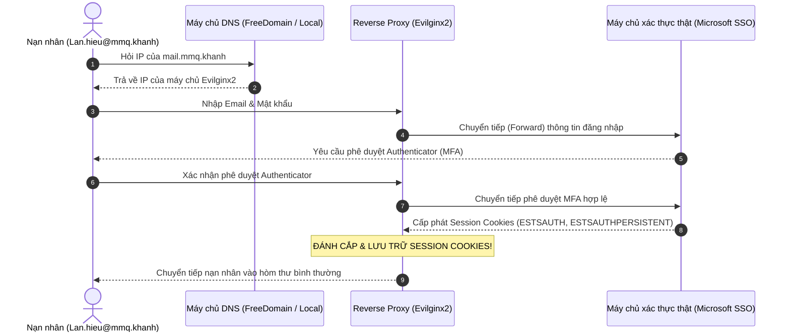

# Dự Án IAO202: Bypass MFA bằng Reverse Proxy - AiTM

> **Chuyên ngành:** An Toàn Thông Tin 
> **Project Timeline:** 19/10/2026 ➔ 30/10/2026  
> **Nhóm thực hiện:** Lương An, Khanh, Hiếu, Quang  

---

## 📖 1. Tổng Quan và Cơ Chế Kỹ Thuật 

### Khác biệt bản chất giữa Phishing truyền thống và AiTM Reverse Proxy:
* **Phishing truyền thống (Credential Harvesting):** Kẻ tấn công tạo một trang web tĩnh giả mạo giao diện để lừa nạn nhân nhập username và password
  => Khi hệ thống bật MFA (mã OTP hoặc xác nhận qua Authenticator), kẻ tấn công chỉ có mật khẩu mà không thể đăng nhập vì thiếu mã MFA (mã OTP hết hạn sau 30-60 giây).
* **Tấn công AiTM (Adversary-in-the-Middle) qua Reverse Proxy:**
  - Kẻ tấn công **không cần tự xây dựng trang web đăng nhập giả**. Thay vào đó, máy chủ Reverse Proxy (sử dụng **Evilginx2**) hoạt động như một lớp màng lọc trung gian hoàn toàn trong suốt.
  - Nạn nhân tương tác với hệ thống thật qua proxy: đọc email, chuyển tiếp request, nhập OTP, duyệt thông báo xác thực như bình thường.
  - **Mục tiêu là Session Theft:** Khi người dùng hoàn tất bước xác thực MFA với máy chủ thật, máy chủ thật sẽ cấp phát **Session Cookie** (ví dụ: `ESTSAUTH`, `ESTSAUTHPERSISTENT` của Microsoft). Reverse Proxy bắt trọn gói tin chứa Session Cookie này, cho phép kẻ tấn công nạp cookie vào trình duyệt và chiếm quyền điều khiển tài khoản vĩnh viễn cho đến khi cookie die => bypass MFA.

---

## 📌 2. Attack Script | Scenario: Công Ty MMQ

* **Victim:** Nhân viên Lan Hiếu (`Lan.hieu@mmq.khanh`) thuộc Công ty Cổ phần MMQ.
* **Hình thức tiếp cận:** Gửi Email mạo danh Bộ phận Quản trị CNTT (IT Department) thông báo *"Mật khẩu tài khoản Office365/Email của bạn đã hết hạn trong 24 giờ tới. Vui lòng bấm vào liên kết để gia hạn mật khẩu"*.
* **Đường dẫn bẫy:** Trỏ về tên miền được proxy qua Evilginx: `mail.mmq.khanh` (hoặc subdomain public).
* **Quá trình thực thi:**
  1. Nạn nhân bấm vào liên kết, thấy trang web hiển thị y hệt hệ thống thật.
  2. Nạn nhân nhập mật khẩu và hoàn tất bước xác nhận ứng dụng Microsoft Authenticator.
  3. Reverse proxy chuyển tiếp toàn bộ lưu lượng tới máy chủ Microsoft thật.
  4. Microsoft chứng thực hợp lệ và trả về Session Cookie.
  5. Evilginx bắt giữ Session Cookie và lưu trữ vào cơ sở dữ liệu của kẻ tấn công.



---

## 📂 3. Cấu Trúc Dự Án (Hierarchical Structure)

```text
Project_IAO_MFA_bypass_by_reverse_proxy/
├── README.md                                      # Tài liệu tổng quan, lộ trình & phân công nhiệm vụ
├── build_environment.sh                           # Script tự động kiểm tra & cài đặt môi trường
│
├── Tools/                                         # THƯ MỤC CÔNG CỤ TẤN CÔNG & TÊN MIỀN
│   ├── README.md                                  # Giải thích vai trò của Evilginx2 & Freedomain
│   ├── Evilginx2/                                 # Mã nguồn & file thực thi Reverse Proxy (build/evilginx)
│   ├── Freedomain/                                # Tài liệu & cơ chế ủy quyền DNS (DigitalPlat .dpdns.org)
│   └── Phishlets/                                 # Thư viện kịch bản Phishlet (Microsoft, Outlook, AWS...)
│
├── Dns_lab/                                       # PHÒNG LAB THỰC NGHIỆM NỘI BỘ (DRY RUN)
│   ├── README.md                                  # Hướng dẫn chi tiết chạy thử nghiệm nội bộ
│   ├── dnsmasq.conf                               # Cấu hình DNS Server nội bộ (cổng 5353)
│   ├── start_dns.sh                               # Khởi động DNS Server (chế độ debug trực quan)
│   ├── stop_dns.sh                                # Dừng an toàn DNS Server
│   ├── test_dns.sh                                # Script tự động kiểm tra phân giải DNS
│   ├── start_web.sh                               # Khởi động Web Server cổng 80
│   └── index.html                                 # Giao diện Microsoft SSO chuẩn Fluent Design (có MFA)
│
└── challenges/                                    # BỘ BÀI TẬP CTF FORENSICS (3 CẤP ĐỘ)
    ├── 01-mfa-traffic-analysis/                   # Level 1 (250 pts): Điều tra lưu lượng AiTM HTTP
    ├── 02-jwt-token-replay/                       # Level 2 (350 pts): OAuth2 Refresh Token Replay
    └── 03-tls-aitm-decryption/                    # Level 3 (500 pts): Giải mã gói tin TLS 1.3 với SSL Keylog
```

---

## 👥 4. Task Assignment

| Thành viên | Nhiệm vụ chính | Chi tiết công việc cần hoàn thành |
| :--- | :--- | :--- |
| **Lương An & Khanh** | **DNS Server & Web Hosting** | • Triển khai và quản trị máy chủ DNS nội bộ (`Dns_lab`).<br>• Thiết lập hệ thống DNS công khai qua **FreeDomain** (`.dpdns.org`).<br>• Cấu hình bản ghi NS (Nameserver Delegation) trỏ về IP công khai của máy chủ để phục vụ Evilginx cấp chứng chỉ SSL Let's Encrypt.<br>• Phụ trách mở cổng mạng (Port Forwarding 53/80/443) hoặc triển khai VPS Cloud. |
| **Quang & Hiếu** | **Phishlet Script & Tinh chỉnh Proxy** | • Nghiên cứu cấu trúc Phishlet YAML của Microsoft 365 / Outlook.<br>• Tùy biến kịch bản Phishlet cho mục tiêu `mail.mmq.khanh`.<br>• Cấu hình bóc tách dữ liệu và bắt chuẩn xác các Cookie cốt lõi (`ESTSAUTH`, `ESTSAUTHPERSISTENT`, `SignInStateCookie`).<br>• Kiểm thử luồng bắt cookie tự động và chuyển hướng nạn nhân sau khi hoàn tất. |

---

## 📅 5. Detail Plan | 19/10/2026 ➔ 30/10/2026

### Những việc đã hoàn tất (Tính đến ngày 13/10/2026):
- [x] script tự động hóa môi trường -> Kali Linux => [`build_environment.sh`](build_environment.sh).
- [x] Xây dựng và nghiệm thu 100% bộ 3 thử thách CTF thực hành độc lập (`challenges/`).
- [x] Xây dựng phòng lab DNS nội bộ (`Dns_lab/`) với `dnsmasq` và giao diện Microsoft SSO demo. 
- [x] Tổ chức và phân loại bộ công cụ tại `Tools/` .

### Kế hoạch cần thực hiện trước ngày 30/10/2026:
* **Giai đoạn 1 (19/10 - 22/10): Hoàn thiện hạ tầng DNS công khai (Lương An + Khanh phụ trách)**
  - Đăng ký subdomain qua FreeDomain (`.dpdns.org`).
  - Cấu hình Nameserver delegation trỏ về Public IP.
  - Mở cổng 53 UDP trên router hoặc đưa lên VPS Cloud để nhận DNS query toàn cầu.
* **Giai đoạn 2 (23/10 - 26/10): Phát triển & Tinh chỉnh Phishlet (Quang + Hiếu phụ trách)**
  - Hoàn thiện file cấu hình Phishlet cho công ty MMQ (`mmq_mail.yaml`).
  - Tích hợp vào Evilginx2 và xin cấp phát chứng chỉ SSL Let's Encrypt tự động.
* **Giai đoạn 3 (27/10 - 29/10): Kiểm thử tích hợp tổng thể (End-to-End Testing)**
  - Đóng vai nạn nhân truy cập liên kết qua Internet.
  - Xác nhận bắt thành công Session Cookie trên Evilginx2 
  - Sử dụng công cụ Cookie-Editor để nạp Session Cookie vào trình duyệt và xác minh quyền truy cập tài khoản không cần MFA.
* **Giai đoạn 4 (30/10): Báo cáo tổng kết**
  - Hoàn thiện báo cáo Project, presentation slides và video demo.

---

## 🛡️ 6. Giải Pháp Phòng Thủ (Defensive Solutions)

Khi hiểu rõ bản chất của kỹ thuật AiTM, ta thấy các phương thức MFA truyền thống (SMS OTP, Email OTP, Authenticator TOTP) hoàn toàn **bất lực** trước Reverse Proxy. Để ngăn chặn triệt để, nhóm nghiên cứu đề xuất các giải pháp:

1. **Xác thực kháng Phishing bằng FIDO2 / WebAuthn (Khóa bảo mật phần cứng - YubiKey):**
   - *Cơ chế:* FIDO2 sử dụng cặp khóa bất đối xứng và thực hiện ký điện tử ràng buộc chặt chẽ với **tên miền gốc (Domain Binding / Origin Validation)**.
   - Khi nạn nhân cắm YubiKey trên trang `mail.mmq-phish.dpdns.org`, thiết bị phần cứng sẽ phát hiện tên miền không khớp với tên miền đã đăng ký ban đầu (`login.microsoftonline.com`) và từ chối ký mã xác thực ➔ **Cuộc tấn công AiTM bị vô hiệu hóa hoàn toàn.**
2. **Chính sách truy cập có điều kiện (Conditional Access Policies):**
   - Chỉ cho phép đăng nhập từ các thiết bị đạt chuẩn an toàn doanh nghiệp (Intune Managed / Microsoft Entra Joined).
   - Thiết lập rào cản IP tin cậy (Trusted Corporate IP/VPN).
3. **Đánh giá quyền truy cập liên tục (Continuous Access Evaluation - CAE):**
   - Tự động thu hồi token khi người dùng thay đổi địa chỉ IP hoặc phát hiện vị trí địa lý bất thường (Impossible Travel).
4. **Token Binding:**
   - Khóa chặt Session Token vào kênh TLS của thiết bị nạn nhân; kẻ tấn công dù lấy được cookie sang máy khác cũng không dùng được.

*(Ghi chú: Nội dung phòng thủ sẽ được cập nhật và kiểm chứng thực nghiệm chi tiết hơn trong báo cáo chính thức ngày 30/10).*
